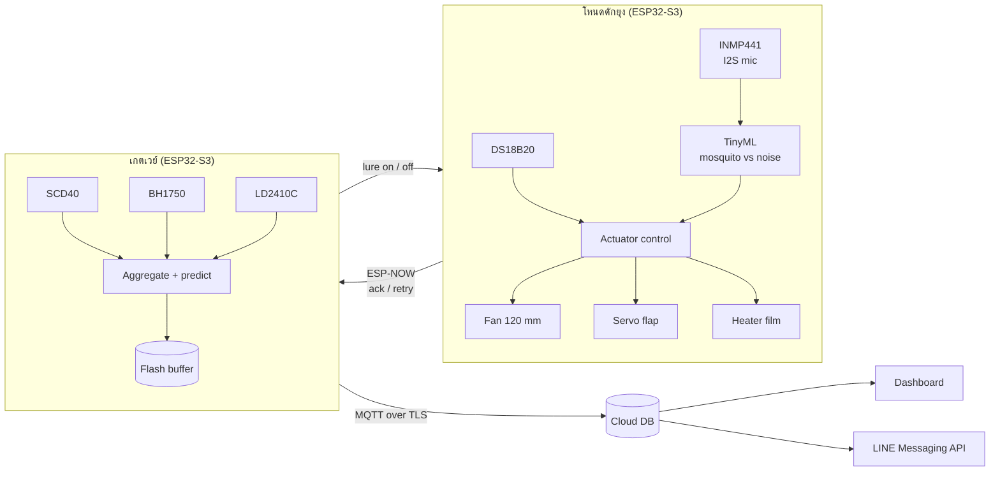

# MozTrap: AI Mosquito Detection and Trapping System

เครื่องดักยุงอัจฉริยะที่ใช้ AI ฟังเสียงกระพือปีกยุงบน ESP32-S3 แล้วสั่งพัดลมดูดยุงเข้าถุงเฉพาะตอนที่ตรวจพบ ล่อยุงด้วย CO₂ จากยีสต์และความร้อนใกล้เคียงผิวคน ไม่ใช้สารเคมี จึงเปิดใช้ตอนคนนอนอยู่ได้

โปรเจกต์จบวิชา **Embedded System (2110356)** ภาควิชาวิศวกรรมคอมพิวเตอร์ จุฬาลงกรณ์มหาวิทยาลัย ปีการศึกษา 2569 ภายใต้ธีม *Smart Devices*

---

## ปัญหา

ยุงรบกวนการนอนของนิสิตที่อยู่หอพักและคอนโด และเป็นพาหะของโรคอย่างไข้เลือดออก วิธีที่ใช้กันทั่วไปยังไม่ตอบโจทย์

- เครื่องไล่ยุงไฟฟ้าและสเปรย์ปล่อยสารเคมีต่อเนื่องแม้ไม่มียุง และใช้ตอนมีคนอยู่ใกล้ไม่ได้
- เครื่องดักยุงที่ขายทั่วไปส่วนใหญ่ล่อด้วยไฟ UV ซึ่งได้ผลกับยุงน้อย
- ไม่มีข้อมูลว่ามียุงมากแค่ไหน มาช่วงเวลาไหน และวิธีที่ใช้ได้ผลจริงหรือไม่

## จุดต่างจากเครื่องดักยุงทั่วไป

| | เครื่องดักยุงทั่วไป | MozTrap |
| --- | --- | --- |
| ตัวล่อ | ไฟ UV | CO₂ (ยีสต์ + น้ำตาล) และฟิล์มความร้อน ~37°C |
| พัดลมดูด | เปิดตลอดเวลา | AI สั่งเปิดแรงเมื่อตรวจพบยุง |
| ข้อมูล | ไม่มี | จำนวนยุงรายโหนดและรายชั่วโมงบนแดชบอร์ด |
| การตัดสินใจ | ตั้งเวลาหรือเปิดค้าง | AI ทำนายช่วงยุงออก แล้วเปิดตัวล่อล่วงหน้า |

---

## สถาปัตยกรรมระบบ



### Closed loop ของ AI

1. **ตรวจจับยุงบนโหนด (on-device):** โมเดลจำแนกเสียง 2 คลาส `mosquito` / `noise` รันบน ESP32-S3 ทุก 250 ms
   - นับเป็น "เจอยุง" เมื่อความมั่นใจ ≥ 0.8 อย่างน้อย 3 ใน 5 หน้าต่างล่าสุด
   - จากนั้นเปิดฝาช่องดัก เปิดพัดลมเต็มรอบ 10 วินาที แล้วปิด รอ 1 วินาทีให้เงียบก่อนฟังต่อ
2. **ทำนายช่วงยุงออกบนเกตเวย์:** ใช้เวลา อุณหภูมิ ความชื้น แสง CO₂ การมีคนอยู่ และจำนวนยุงย้อนหลัง ทำนายจำนวนยุงในอีก 30 นาที แล้วสั่งเปิดหรือปิดตัวล่อ (ฮีตเตอร์ + พัดลมรอบต่ำ) ของแต่ละโหนด

> เสียงพัดลมของเครื่องเองกลบเสียงยุง ระบบจึงฟังสลับกับดูด (duty cycle) ไม่ฟังระหว่างที่พัดลมทำงานแรง

---

## ฮาร์ดแวร์

### เซนเซอร์ (5 ชนิด)

| ตำแหน่ง | อุปกรณ์ | หน้าที่ | อินเทอร์เฟซ |
| --- | --- | --- | --- |
| โหนด | INMP441 | ฟังเสียงกระพือปีกยุง | I2S |
| โหนด | DS18B20 (probe) | วัดอุณหภูมิฟิล์มความร้อน | 1-Wire |
| เกตเวย์ | SCD40 | CO₂ อุณหภูมิ ความชื้นของห้อง | I2C (0x62) |
| เกตเวย์ | BH1750 | ความเข้มแสง | I2C (0x23) |
| เกตเวย์ | LD2410C | ตรวจว่ามีคนอยู่ในห้อง (mmWave 24 GHz) | UART + OUT |

### ตัวขับ

| อุปกรณ์ | หน้าที่ | ควบคุมด้วย |
| --- | --- | --- |
| Arctic P12 Pro PST (120 mm, 4-pin) | ดูดยุงลงถุงตาข่าย | PWM 25 kHz + อ่าน TACH |
| MG996R | เปิดปิดฝาช่องดัก กันยุงหนีตอนพัดลมหยุด | PWM 50 Hz |
| ฟิล์ม polyimide 12V 4.5W | ตัวล่อความร้อน ~37°C | IRLZ44N + PID |

### ส่วนอื่น

- ESP32-S3 DevKitC-1 N16R8 × 2 (โหนด + เกตเวย์)
- ท่ออะคริลิกใส ID 114 / OD 120 mm ยาว 25 ซม., ถุงไนลอน 100 mesh
- ชุดผลิต CO₂ จากยีสต์, แผ่นเทปฟอยล์อะลูมิเนียมกระจายความร้อน
- อะแดปเตอร์ 12V 2A, LM2596 (12V → 5V), IRLZ44N, ตัวเก็บประจุ 10000 µF, ตัวต้านทาน 4.7 kΩ

### การต่อขา

ขาสัญญาณทั้งหมดอยู่บนหัวต่อ **J1** ของ DevKitC-1

**โหนด**

| ขา ESP32 | ต่อกับ | หมายเหตุ |
| --- | --- | --- |
| GPIO4 | INMP441 SCK | I2S BCLK |
| GPIO5 | INMP441 WS | I2S LRCLK |
| GPIO6 | INMP441 SD | ขา L/R ของไมค์ต่อ GND |
| GPIO7 | DS18B20 DAT | บอร์ดโมดูลมี pull-up 4.7 kΩ แล้ว |
| GPIO15 | พัดลม ขา 4 (PWM) | วัดแรงดันขานี้ก่อนต่อ ถ้าราว 5V ให้ขับผ่าน MOSFET แบบ open-drain |
| GPIO16 | พัดลม ขา 3 (TACH) | 4.7 kΩ pull-up ไป 3V3, interrupt |
| GPIO17 | MG996R signal | ไฟเลี้ยงเซอร์โว 5V จาก LM2596 |
| GPIO18 | IRLZ44N Gate | 4.7 kΩ จาก Gate ลง GND |

**เกตเวย์**

| ขา ESP32 | ต่อกับ | หมายเหตุ |
| --- | --- | --- |
| GPIO15 | SDA (SCD40, BH1750) | `Wire.begin(15, 16)` |
| GPIO16 | SCL (SCD40, BH1750) | |
| GPIO17 | LD2410C RX | UART1 TX, 256000 baud |
| GPIO18 | LD2410C TX | UART1 RX |
| GPIO8 | LD2410C OUT | HIGH = มีคน, interrupt |

> ก่อนจ่ายไฟครั้งแรก: ตั้ง LM2596 ให้ออก 5.0V ก่อนต่อโหลด, GND ทุกจุดต้องต่อรวมกัน, อย่าจ่ายไฟ USB กับขา 5V พร้อมกัน

---

## โครงสร้าง repository

```
.
├── node/            # เฟิร์มแวร์โหนด (FreeRTOS, I2S, inference, actuator control)
├── gateway/         # เฟิร์มแวร์เกตเวย์ (ESP-NOW, sensors, MQTT/TLS, flash buffer)
├── ai/
│   ├── audio/       # สคริปต์เตรียมข้อมูลเสียง + ไลบรารีที่ export จาก Edge Impulse
│   └── predict/     # โมเดลทำนายช่วงยุงออก
├── dashboard/       # เว็บแดชบอร์ด + LINE notification
├── hardware/        # ผังวงจร, BOM, โมเดล 3D ตัวเครื่อง
├── docs/            # proposal, test plan, ผลการทดสอบ, รายงาน
└── README.md
```

---

## เริ่มต้นใช้งาน

### 1. เฟิร์มแวร์

ต้องมี Arduino IDE 2.x หรือ PlatformIO พร้อม ESP32 board package (Espressif)

1. Clone repository
2. คัดลอก `node/secrets.example.h` เป็น `node/secrets.h` และ `gateway/secrets.example.h` เป็น `gateway/secrets.h` แล้วกรอกค่า
   ```c
   // gateway/secrets.h  (ไฟล์นี้อยู่ใน .gitignore ห้าม commit)
   #define WIFI_SSID      "..."
   #define WIFI_PASSWORD  "..."
   #define MQTT_HOST      "..."
   #define MQTT_PORT      8883
   #define MQTT_USER      "..."
   #define MQTT_PASSWORD  "..."
   ```
3. เลือกบอร์ด **ESP32S3 Dev Module** เปิด **PSRAM: OPI PSRAM**
4. แฟลช `gateway/` ก่อน จด MAC address ที่ขึ้นใน Serial Monitor แล้วใส่ใน config ของ `node/`
5. แฟลช `node/`

### 2. โมเดลเสียง

1. Clone โปรเจกต์สาธารณะ [Mosquito detection using TinyML](https://studio.edgeimpulse.com/public/66054/latest) เข้าบัญชี Edge Impulse
2. เพิ่มคลิปยุงลาย (*Aedes aegypti*, *Aedes albopictus*) จาก [HumBugDB](https://zenodo.org/record/4904800) แปลงเป็น 16 kHz
3. เพิ่มเสียง noise ที่อัดด้วย INMP441 ในห้องจริง (แอร์ พัดลม เสียงพูด)
4. ใช้ MFE + NN classifier, quantize เป็น int8
5. Export เป็น **Arduino library** แล้ววางไว้ใน `ai/audio/`

### 3. คลาวด์และแดชบอร์ด

ดูรายละเอียดใน `dashboard/README.md`

---

## รูปแบบข้อมูล

**โหนด → เกตเวย์ (ESP-NOW, JSON)**

```json
{"node_id": "trap-01", "seq": 1042, "ts": 1793000000, "event": "detect", "confidence": 0.91, "heater_c": 36.4, "fan": "high"}
```

**เกตเวย์ → โหนด**

```json
{"node_id": "trap-01", "cmd": "lure", "value": "on", "seq": 77}
```

โหนดตอบ ack ด้วย `seq` เดียวกัน ถ้าไม่ได้ ack ภายในเวลาที่กำหนดจะส่งซ้ำ

**MQTT topics**

| Topic | ข้อมูล |
| --- | --- |
| `moztrap/<node_id>/event` | เหตุการณ์ตรวจพบยุงและการทำงานของตัวขับ |
| `moztrap/<node_id>/status` | อุณหภูมิฮีตเตอร์ รอบพัดลม สถานะออนไลน์ |
| `moztrap/gateway/env` | CO₂ อุณหภูมิ ความชื้น แสง การมีคนอยู่ |
| `moztrap/<node_id>/cmd` | คำสั่งเปิดปิดตัวล่อ |

---

## Embedded Engineering Depth

| ข้อ | สิ่งที่ทำ |
| --- | --- |
| E1 RTOS multitasking | FreeRTOS บนโหนด: task รับเสียง (I2S DMA), inference, ควบคุมตัวขับ, สื่อสาร เชื่อมด้วย queue และ event group |
| E2 Interrupt-driven I/O | นับรอบพัดลมจาก TACH และอ่าน OUT ของ LD2410C ด้วย interrupt |
| E4 Reliable communication | ESP-NOW พร้อม ack/retry และ sequence number, เกตเวย์พักข้อมูลลง flash ตอนออฟไลน์แล้วส่งย้อนหลัง |
| E5 Security | MQTT over TLS พร้อม username/password, ความลับอยู่ในไฟล์ที่ไม่ commit |
| E7 On-device AI | โมเดลตรวจจับเสียงยุงรันบน ESP32-S3 |

---

## การทดสอบ

ติดตั้งจริงในห้องพักของสมาชิก ทดสอบต่อเนื่องอย่างน้อย 24 ชั่วโมง และในห้องจริงอย่างน้อย 7 คืน

| Metric | วิธีวัด |
| --- | --- |
| AI precision / recall | เทียบจำนวนที่ AI ตรวจพบกับจำนวนยุงในถุงที่นับด้วยมือ และทดสอบกับเสียงที่อัดเองใน 3 สภาพ: ห้องเงียบ เปิดแอร์ มีคนคุยกัน |
| Packet delivery rate | นับ `seq` ที่เกตเวย์ได้รับเทียบกับที่โหนดส่ง |
| End-to-end latency | เวลาจากตรวจพบยุงถึงพัดลมทำงาน และถึงแสดงบนแดชบอร์ด |
| Uptime | ทดสอบต่อเนื่องอย่างน้อย 24 ชั่วโมง |

กรณีล้มเหลวที่ทดสอบ: Wi-Fi หลุด, คลาวด์ล่ม, ถอดเซนเซอร์ระหว่างทำงาน, ไฟดับ

ผลการทดสอบอยู่ใน `docs/`

---

## ความปลอดภัย

- ตะแกรงครอบพัดลม และ timeout ของพัดลมกับเซอร์โว
- จำกัด duty ของฮีตเตอร์ในเฟิร์มแวร์ และตัดอัตโนมัติเมื่อเกิน 40°C
- ขวดยีสต์วางบนถาดรอง แยกจากวงจร และมีทางระบายแรงดัน
- ไฟบ้านเข้าผ่านอะแดปเตอร์สำเร็จรูปเท่านั้น

---

## ทีม

| สมาชิก | บทบาท |
| --- | --- |
| [ชื่อ] | System Architect & Integration, Gateway & Cloud |
| [ชื่อ] | Embedded Developer (Sensor Node) & AI |
| [ชื่อ] | Dashboard Developer, Project Manager & Test Lead |

---

## อ้างอิงและเครดิต

- Kiskin et al., *HumBugDB: A Large-scale Acoustic Mosquito Dataset*, NeurIPS Datasets and Benchmarks 2021 · [humbug.ox.ac.uk](https://humbug.ox.ac.uk/article/neurips) · [Zenodo](https://zenodo.org/record/4904800) · [GitHub](https://github.com/HumBug-Mosquito/HumBugDB)
- Shankar-16, *Mosquito detection using TinyML* (Edge Impulse public project) · [studio.edgeimpulse.com/public/66054](https://studio.edgeimpulse.com/public/66054/latest)
- M. Rovai et al., *wingbeat-mosquito-tinyml*, ACM Conference on Information Technology for Social Good 2022 · [GitHub](https://github.com/Mjrovai/wingbeat-mosquito-tinyml)
